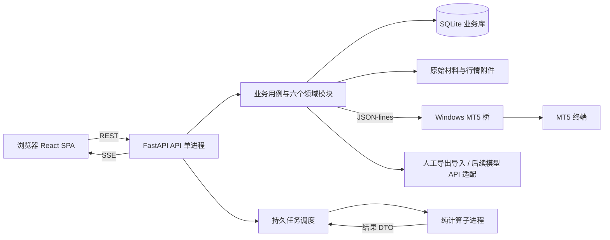

# XAU-Next 技术架构规格

结构检查26：analysis/document_candidate包装原25，json_document只做严格解析、Schema派生结构指导和只读语法定位；不拥有存储、不生成行情或方向、不修复返回字节。AnalysisService统一使用严格解析后仍走原完整校验；daily_analysis仅在已有SCHEMA_INVALID且原回答存在时派生显示详情，不覆盖model_call文档。API1.14.4保留candidate26，新日常分析默认26，旧24/25窗口更新保留原模板；无迁移、无密钥/模型I/O，实际正式状态见packet26_activation_20261029任务。

时间检查25：analysis/timing_candidate显式包装24，entry_schedule通过shared/entry_timing原函数生成48行时间基准并逐层投影，不改变原时间政策。daily_analysis只在已有ENTRY_WINDOW_INSUFFICIENT且原答案存在时读取保存附件，调用analysis公开纯诊断函数，向可选DailyArm.entry_timing_diagnostics投影；不保存新状态或读供应商凭据。前端DailyResults使用已有call证据区分失败原因，原文按点击GET加载。API1.14.3、答案1.7.0、无迁移；授权切换后新分析默认25，新建选择不列24，历史24窗口更新仍保留原分支，实际部署状态看任务图。

可选候选24：analysis/forecast_candidate复用原23构包与外发投影后显式包装forecast-deliberation/1，package/model_api仅在24分支调用，历史14/23路径保持。工作表逐层白名单投影，旧统计与原始资料由forecast_reference核对。workflows/analysis_lab显式选择24，保存/发送/导入/更新沿普通日常流程，外发修订独立记录；公开API1.14.2只增加daily的candidate24枚举，页面默认23、24手动选择，历史筛选24单列。原离线工具及产物保留为当时证据；当前实施和正式状态见任务图。

准备性能：GET /v1/analysis/daily/source由workflows读取market公开服务，只投影已保存行情身份，不经过workspace历史查询。shared/preparation_timing通过ContextVar在单次HTTP及线程池调用间传递单调时钟计时，输出本地白名单诊断；db核心仅在活动计时作用域测量写锁等待与提交，不改变事务语义。公开API1.14.1为只读新增，无答案格式、依赖、迁移或存储格式变化。

供应商日常路由：settings拥有每连接可选模型清单、Chat输出参数及显式启用状态；analysis/daily保存本轮位置对应的实际模型与连接ID，并仅以公开白名单投影冻结调用配置。workflows/daily_analysis在注册调用时读取保存连接、冻结配置并保留派发前配置一致性检查；新请求不再按A—D推断厂商。daily_performance按冻结渠道和配置分组，不从当前设置追溯填充。gateway只序列化显式协议和参数，不自动切换或重试；原Schema与导入校验不变。API1.14为可选扩展，旧式请求路径保留，无新依赖、数据库迁移或MT5写操作。

候选23官方实际值：platform/economic_calendar/umich只读取固定公开大学URL并保守解析指定月份/初终值，保存原网页由tooling完成；不读凭据、数据库或模型。analysis/economic_actuals负责纯截止校验和日历指标匹配，economic_context分别保留日历与actual_source_id来源，并输出已公布历史背景；project_economic_context重核实际值，forecast_review_input只从验证后的事件派生状态。package/model_api仅显式23版加入新资料及规则，shared_search登记真实官方来源ID，selection绑定独立输入修订和资料哈希。没有公开HTTP/答案格式、生成客户端、数据库迁移、正式配置或MT5变更；14/17—22分支保持。

共享搜索实验21：platform/economic_calendar/search只允许官方固定Search端点、每次最多3条结果、有界响应，无自动重试；凭据仍由实验控制器从本应用引用读取。analysis/shared_search纯函数验证获取/发布时间与冻结截止、逐字段投影来源，并仅对21版外发Schema收窄实际案例ID枚举；原答案契约及业务校验不变。economic_context/package/model_api仅显式21版携带共享资料，四模型收到同一输入且不启用原生搜索。selection独立封存4次共享账本追加54至58，旧三模型扩展规则保留。bridge历史校验以最新报价读取时刻核对时钟，保留采集起止证据，不回写旧历史。

隔离经济资料扩展：platform/economic_calendar只进行一次固定公开URL的有界HTTP读取及字段转换，保留原件哈希，不访问业务库、凭据或模型。analysis/economic_context纯函数拥有截止时间校验、组件缺口、逐周期事件映射和逐层白名单；package/model_api仅对显式20版构包与投影，旧分支及默认版本不变。workflows/model_selection绑定封存计划中的资料哈希和研究模式；tooling先取数，再只读复用已存行情冻结新请求。共享模式不启用独立搜索；native_search_probe在gateway显式开放服务端工具并核对真实协议证据，不能进入同输入评分。无HTTP/答案契约、生成客户端、数据库迁移或正式配置变更。

r29隔离候选：`analysis/forecast_reference`仅对冻结request/context进行纯Decimal比较，复核原统计与原始闭柱一致，区分当前Bid和旧闭柱锚点，并生成按原端点的描述性参照。`analysis/package`仅为prompt16冻结此摘要；`analysis/model_api`以逐层白名单投影，workflows仅登记projection9。没有跨域读表、外部数据采集、模型生成、方向选择或新交易校验；旧版本分支与答案契约保持。

候选r28的analysis/entry_selection只从调用者冻结资料派生三种入场方式比较上下文：明确Bid/Ask及未知，复用shared/entry_timing计算无额外检查的基线时间表，不选择方式、不生成新价格、不操作旧方案。package仅为15版冻结，model_api逐层白名单投影为api-projection/8；14版decision_context及原流程保留。沿用现有答案理由字段，HTTP/答案契约、前端和业务存储无变更；语义在主规格5.5，动态状态在任务图entry_choice_r28。

本文为架构要求。各项实际实现和验收证据见 docs/VALIDATION.md；不由架构描述推定已通过。核验日期：2026-10-12（北京时间）。

本文规定新项目怎样实现；业务行为以 `REBUILD_SPEC.md` 为准，线上交换格式以 `contracts/` 为准。
本文中的目录、命令、性能和恢复行为是实现要求，不表示相关代码已经存在。

## 1. 架构目标

建设 Windows 上单用户使用的 XAUUSD 人工决策与复盘工具，支持不同 Agent 独立开发、自动验证和持续改进。
前端和后端有独立源码、依赖、构建产物、进程及发布流程，仅通过公开协议通信。
核心业务使用确定性程序计算；模型负责解释、分析和建议，通过标准答案契约接入。
1.1 的当前入场/退出判断由 plans 的纯计算接口负责，analysis 负责固定分析时效、上下文和更新请求，portfolio 提供真实关联和成交起点；workflows/guidance 只组合这些公开接口。网页与本机通知读取同一份行动建议。通知内容和投递尝试由 platform/notifications 的持久 outbox 保存，Windows 适配器只负责本机送达，不访问 MT5。独立提示线程处理到期和投递；外部通知及只读保证金计算均不占用数据库写事务。通知表迁移只新增表，迁移前自动备份，不改历史回答和复盘。

一次性入场资格使用 portfolio 的 execution / plan_usage 文档投影：精确券商对象的已执行证据与人工关联在同一事务内产生不可撤回的 USED 标记；通知记录与参考回放不参与耗用。启动时只追加旧成交和关联的投影，不改旧文档；证据不足保留 UNKNOWN。workflows 通过 portfolio.entry_usage 获取 USED／UNKNOWN／UNUSED，交给 plans 的纯判断函数生成行动状态。USED 不修改 Plan.lifecycle，避免影响历史参考回放和已有持仓退出规则。

shared/closed_bars 只从给定冻结事实核验当前闭柱窗口，不读取数据库或修改来源状态；plans 条件判断与 analysis 分析包使用同一核验结果。历史覆盖不完整与当前闭柱可核验性分别呈现。重评条件缺资料通过 WAITING_DATA 表达，通知与自动请求流程只响应到期或已证实需要重评的状态。
答案1.2起的candidate_assessments由analysis随原回答保存并校验启用模式覆盖、方案引用及无候选缺口；workflows在同一工作台快照中原样投影，不生成模型原因。新请求1.3增加post_activation_invalidation；plans独立拥有阶段生命周期和行动资格，review对新阶段方案标识bidask_reference/2，旧定义与旧复盘不重写。预测复盘1.3继续沿用prediction_review/2。

最低观察时间的纯计算位于shared/entry_timing；analysis冻结耗时参考、验证计划时间并在实际导入时保存派生entry_timing到plan_drafts，plans注册时保持该证据并用于当前资格。workflows仅将旧方案的只读时间展示组合进建议，不追溯写入历史。所有新字段来自唯一契约，沿用现有文档存储和修订机制，无数据库迁移。具体阶段与期限语义以主规格为准。
plans/advice在当前资格计算中区分limit_retest等待与market/stop_breakout追入边界；workflows对既有MISSED仍保持锁存，不通过升级回放改写旧行动状态。invalidation仍由原生命周期引擎在两个阶段统一检查，说明在契约描述、分析包与界面明确，不增加隐式阶段状态。
analysis/refresh明确区分准备提醒与停止资格；plans提供具体停止依据和候选期限，workflows组合为同一快照。模型重评的首次确认由analysis追加reassessment_observation文档，不复用行情返回来撤销已经确认的重评事实。临时缺资料不建立此记录。通知outbox按准备/必须更新阶段分别去重，旧无阶段通知继续尊重原去重身份。时间拆分与观察预算由shared/entry_timing统一计算，stopping_reason为共享值结构；页面不另写业务状态，只按后端依据和已知截止显示。仍无新表迁移。
更强模型到来时，更换适配器、提示模板与评测配置即可，不重写业务数据库或前端。
`shared/scalp`拥有版本化超短线偏好及纯Decimal有效入场范围、阈值位移、全区间空间和适配诊断；analysis冻结偏好并生成导入证据，plans实时复算与原金额函数对每个边界核验，workflows与界面只消费结果。`shared/near_term`从冻结完整行情生成连续闭柱近端统计并显式投影，不读数据库。旧方案没有冻结偏好时不启用新规则，当前设置显示默认值不回写历史修订。新契约1.6/答案1.5以可选派生字段兼容旧记录，无新数据库表；原持仓管理不依赖新偏好。API行式OHLC编码无损，经验仍由既有明确嵌套映射负责。
review对新偏好方案选`bidask_reference/3`，当前缺少完整逐时点资格轨迹时保留未知，不调用旧精确限价成交模拟；旧方法与旧结果不迁移。health的契约版本由bootstrap注入已加载的权威OpenAPI版本，避免另一个硬编码版本与候选身份失配。
常规新请求周期由shared/analysis_policy提供默认集合，analysis在冻结创建时解析；更新从原forecast继承。页面和guidance不再合并/截断周期，显式自定义API仍保留，RequestCreate可省略horizon_minutes，实际AnalysisRequest仍保存完整数组（契约1.6.1，无存储迁移）。model_gateway在现有流解析边界追加model-network/2内部安全时间诊断，经原response_meta保存；不改模型配置、外发提示、答案格式或旧调用元数据。
并行效率来自稳定接口、小而完整的模块、明确所有权和快速验证；进程数量按实际运行需要决定。
本版采用模块化单应用后端，所有业务数据由一个 API 进程管理，MT5 桥独立运行。
analysis/output_constraints拥有可选实验提示17的纯输入投影：枚举取自当次权威Schema，最晚入场截止复用shared/entry_timing，不定义新规则。analysis/package与model_api分别构建和白名单投影同一信息；workflows/model_selection通过封存计划显式选择14或17，默认14，tooling只复用已存快照。日常请求默认、答案校验、原始回答和历史评分不改；该输入修订不会激活正式模型。
同一模块的可选18分支追加根JSON结构指导：从权威Schema派生成员类型与必填字段并投影，package只在18选择该指导，model_selection要求output-constraints/2配对。没有输出修补器或网络重试，完整Schema和业务校验继续执行。14/17字节投影保持，18组单独登记修订。
可选19分支在18基础上从冻结experience.cases派生案例身份清单，并调用analysis/experience.non_experience_references复用当前依据身份集合；不引入跨域读取。output_constraints逐字段白名单投影experience_links，package与model_api只对19启用，model_selection要求output-constraints/3。经验校验器、公开契约、默认分支与旧包保持；没有响应补写、近似匹配或自动重试。
不要求旧代码、旧表名、旧页面或旧版本兼容；需要导入的历史资料另建一次性转换器。

“优雅”的验收是：新增一种分析来源只改分析适配部分；新增页面不复制金额公式；修改计划规则不改行情采集。
能通过机器检查证明这些性质，比宣称使用了某种架构流派更有价值。

## 2. 十项核心技术决策

| 编号 | 决策 | 适用理由与取舍 |
|---|---|---|
| A01 | React + TypeScript + Vite 独立 SPA | 高交互本地工作台，无 SEO 或服务器渲染需求；构建结果可由独立静态服务部署。 |
| A02 | Python + FastAPI 模块化后端 | 复用 Python 行情与分析生态；HTTP、依赖注入和类型验证明确，业务模块保持框架无关。 |
| A03 | 先定义 OpenAPI 3.1 / JSON Schema 2020-12 | 在后端未完成时即可生成客户端、模拟响应和验收样例；契约只有一个维护源。 |
| A04 | SQLite WAL + SQLAlchemy 2 + Alembic | 满足单机读多写少，SQLAlchemy 管理事务和映射，Alembic 管理表结构演进。 |
| A05 | REST 命令与查询 + SSE 状态通知 | 写操作有明确请求结果；页面接受单向更新，暂不需要 WebSocket 双向会话。 |
| A06 | API 内持久任务调度 + 独立计算进程 | 长任务可恢复；慢计算不阻塞页面；首版不依赖 Redis、Celery 或独立队列服务。 |
| A07 | MT5 使用独立 Windows 子进程和 JSON-lines | 主后端的 Python 版本不受 MT5 SDK wheel 约束，采集挂起可单独重启。 |
| A08 | Decimal 金额、UTC 时间、事实与可用时点分开 | 避免浮点金额误差、时区混淆及回放使用未来信息。 |
| A09 | 模型能力配置 + 明确任务输入输出 + 固定评测 | 不把任意模型名或某家 SDK 写入业务模块；换模型能量化比较正确率、延迟与成本。 |
| A10 | 单仓库、多所有权、生成代码、依赖图检查 | 多 Agent 共享契约并在独立目录交付；整合成本可观测，不靠口头约定维持边界。 |

A01 的技术依据：React 官方允许按应用约束选择 Vite；Vite 的构建产物可静态托管。此处选择是本项目判断，并非官方声称 SPA 适合所有产品。[React](https://react.dev/learn/creating-a-react-app)、[Vite](https://vite.dev/guide/build)。
A02–A03 的依据：FastAPI 支持 OpenAPI；OpenAPI 3.1 使用兼容 JSON Schema 的 Schema Object；Pydantic 支持 Draft 2020-12。[FastAPI](https://fastapi.tiangolo.com/features/)、[OpenAPI 3.1](https://spec.openapis.org/oas/v3.1.0.html)、[Pydantic](https://docs.pydantic.dev/latest/concepts/json_schema/)。
A04–A08 的具体依据和实现限制在下文列出；模块划分、进程安排与阈值均为本项目设计，不冒充外部标准。

## 3. 运行结构与源码结构

r25持仓两层管理：Plans执行纯结构/价格/时间核验；Portfolio追加按真实持仓身份与原方案绑定的holding_event，Analysis维护holding_pending/holding_review及原回答版本。Workflows只组合公开服务，构包与提交前重核当前事实，不在读查询中回填。持仓专项请求复用分析传输与严格1.7回答校验，但不发布forecast、不登记新Plan、不替代当前分析，不进入预测复盘分母。外发holding_review使用明确字段投影，原方案与先前重评保持来源和截止边界；Web展示规则状态与独立的模型意见，手动准备包不触发模型。公开格式API1.9.0，生成DTO/SDK仍由contracts统一生成。

r22复盘核对保持领域边界：AnalysisService公开返回请求时冻结的评分依据，MarketService只读解析被引用的既存历史附件并返回最小报价/来源字段，Workflows组合Review纯诊断；GET详情附加当前核对信息，不提交Review修订、不进入原ExperienceDigest、不调用桥或模型。列表不解压全部逐笔历史，详情按review_id/revision缓存。新请求的prediction-quality/2选择prediction_review/3，旧请求保持原方法；明确方法版本区分冻结Bid方向与裁剪M1诊断。



浏览器不直接访问数据库、文件目录、MT5 或模型密钥。
计算子进程不写业务库；它返回结果，由对应业务模块完成一次事务提交。
业务库和附件只有后端能写；MT5 桥只产生读取结果，不维护另一份业务状态。
Web 静态服务与 API 可单独停止、升级和重启；前端能在 API 离线时展示明确连接状态。

```text
XAU-Next/
├─ REBUILD_SPEC.md
├─ apps/
│  ├─ web/
│  │  ├─ src/app/                 # 路由、启动、全局连接状态
│  │  ├─ src/features/            # market/analysis/plans/portfolio/review/settings
│  │  ├─ src/shared/              # 纯展示组件、时间和显示格式
│  │  ├─ src/styles/              # 设计变量、全局样式
│  │  └─ src/api/                 # 生成 SDK 的应用封装与连接管理
│  ├─ api/
│  │  ├─ src/xau_next/
│  │  │  ├─ main.py               # API 入口
│  │  │  ├─ bootstrap.py          # 依赖组装、生命周期
│  │  │  ├─ http/                 # 路由、wire DTO 映射、错误映射
│  │  │  ├─ transport/generated/  # 从 contracts 生成，禁止手改
│  │  │  ├─ workflows/            # 跨领域用例，不拥有业务表
│  │  │  ├─ domains/              # 六个领域模块
│  │  │  ├─ platform/             # DB、任务、事件、文件、日志
│  │  │  └─ shared/               # Money、UTC、ID、通用结果类型
│  │  ├─ migrations/              # Alembic 单一线性迁移历史
│  │  └─ tests/                   # 模块内部测试
│  └─ mt5_bridge/                 # 独立 pyproject、锁文件、SDK 与协议实现
├─ packages/api-client/           # 生成 TS 类型 + 轻量 fetch 调用层
├─ contracts/
│  ├─ openapi.json                # HTTP / SSE 公开契约权威源
│  └─ analysis-answer.schema.json # 模型答案 JSON Schema 权威源
├─ fixtures/                     # 合成样例、输入、预期输出、评测集
├─ tests/                        # 契约、架构、端到端、恢复、性能
├─ tooling/                      # 生成、检查、启动、打包、备份工具
├─ planning/                     # 实施任务、目录所有权、当前批次
└─ docs/                         # 本文、交互设计、必要运行说明
```

仓库保存规范、代码和合成样例；实际账户资料和运行数据放入独立 `DATA_ROOT`。
`planning/` 保存当前工作分配，不能定义另一套业务规则；完成的任务不继续充当产品说明。
不要预建空接口和空目录：以上是允许的结构，按交付批次创建真正使用的部分。

## 4. 模块深度与数据所有权

模块对调用者隐藏公式、数据库、重试和内部状态转移，通过少量完整操作提供行为。
每个模块拥有 `public.py`：只公开用例入口、输入输出和错误；内部文件不构成公共接口。
内部按需要使用 `model.py`、`service.py`、`storage.py`，复杂度不足时不机械拆分。
`public.py` 的稳定接口不返回 ORM 对象、活动数据库 Session、供应商响应或可变共享字典。

| 模块 | 独占写入内容 | 公开能力示例 | 不能承担 |
|---|---|---|---|
| market | 来源身份、合约快照、行情快照和材料索引 | capture_snapshot、get_snapshot、read_window | 预测方向、方案资格、实际交易归因 |
| analysis | 分析包、原始回答、解析结果、分析版本 | build_package、import_answer、get_version | 自行认定成交、覆盖原始回答 |
| plans | 计划版本、触发状态、金额计算、预算判断 | evaluate_plan、get_plan、calculate_sizing | 修改账户事实、从前端接受已算好的结论 |
| portfolio | 账户/订单/成交事实、人工关联和事实修订 | sync_facts、link_plan、get_positions | 生成预测、替交易终端执行订单 |
| review | 复盘输入绑定、计算结果、经验摘要版本 | run_review、get_review、get_context | 把模型评价当成成交事实 |
| settings | 生效配置、预算配置、来源与模型配置引用 | get_snapshot、update_settings | 将每个业务状态都变成配置项 |

`platform` 独占 `jobs`、`events`、`idempotency_requests`、`attachments` 元数据等基础设施表。

多套模型连接由settings在既有documents存储中拥有model_profile、selection、配置修订归属及每套检查/余额投影，无新增数据库表。旧model_settings/current仍是唯一生效配置与冻结修订源；首次采用仅追加保存档，不重写旧设置。workflows协调调用进行中禁止切换和事务幂等；settings保存引用而不转存密钥，按原验证规则引用未变化连接的已有证据；前端只通过契约接口保存和主动切换，不直接维护凭据或生成请求。
每张表必须有一个写入模块；任何其它模块通过公开操作修改它。
跨域查询优先取得不可变快照，由 `workflows` 组合；不直接跨域导入 ORM 或运行任意联表查询。
单一首页聚合接口由 `workflows` 组装，只读取各模块的公开查询结果，避免前端发出几十个请求。
真正需要的高频只读投影可由一个明确 owner 维护；不在首版先建立全库事件重放系统。

### 4.1 可检查的依赖方向

```text
main -> bootstrap
bootstrap -> http / workflows / domain public / platform
http -> transport.generated / workflows / domain public / shared
workflows -> domain public / platform task API / shared
domain public -> 本领域 service / model
domain service -> 本领域 model / storage / platform / shared
domain model -> shared / Python 标准库
domain storage -> SQLAlchemy / platform DB / 本领域 model
platform -> shared / 技术库
shared -> Python 标准库
```

六个领域模块彼此不直接导入；跨域交互由用例层显式传入快照或调用各域公开入口。
`analysis` 使用历史复盘上下文时，`workflows` 先取 `review` 快照再传入，避免 analysis ↔ review 循环。
`plans` 接收市场、账户和配置快照进行计算；它不自己打开 MT5，不依赖页面当前状态。
共享代码只接收确有多个消费者的稳定概念；领域算法不因复用方便而塞进 `shared/utils.py`。
只有出现第二种真实实现或需要隔离外部系统时才增加 Protocol 接缝；不为每个类配一个空接口。
架构测试禁止反向导入、跨模块私有导入、前端直接 HTTP、业务模块导入 MT5 SDK。

## 5. 契约驱动的并行实现

`contracts/openapi.json` 是唯一 HTTP 规范源，答案结构通过相对 `$ref` 引用 `analysis-answer.schema.json`。
答案 JSON Schema 不在 OpenAPI 内复制一份；所有引用必须可离线解析，生成时不下载远程 schema。
公开契约先提交，再并行编写前端、路由与领域实现；临时模拟响应也要通过同一规范验证。

```text
维护：contracts/openapi.json + analysis-answer.schema.json
       ├─ 生成 Python wire DTO -> apps/api/src/xau_next/transport/generated/
       ├─ 生成 TS 类型         -> packages/api-client/
       ├─ 驱动模拟响应/样例验证 -> fixtures/ + tests/contracts/
       └─ 对比实现             -> FastAPI 运行时 OpenAPI + HTTP 响应
```

Python 采用 `datamodel-code-generator` 生成 Pydantic v2 wire DTO；TS 采用 `openapi-typescript` 配合 `openapi-fetch`。
生成器版本、参数与格式化版本一起锁定；生成文件包含来源哈希，可删除后从规范完整重建。
生成范围限于边界数据类型；业务路由和领域逻辑由人或 Agent 实现，避免维护生成的业务框架。
FastAPI 的 `/openapi.json` 是实现派生产物，不能覆盖 `contracts/openapi.json`。
CI 校验路径、方法、状态码、参数、required/null、枚举及响应结构语义兼容，忽略描述和组件重命名差异。
领域模型使用自己的值对象和业务不变量，`http` 显式把 wire DTO 映射为领域输入，避免接口字段牵动数据库。
请求解析后仍按原始 schema 校验关键外部输入，不能假设生成器完整实现所有 JSON Schema 关键字。

首个实现批次先做生成器兼容样例：外部 `$ref`、联合类型、缺省与 null、Decimal 字符串、UTC、嵌套错误。
这些样例同时跑 Python 和 TS；不兼容时修生成配置或选择兼容生成器，不另建一份手写权威类型。
生成器当前文档支持 OpenAPI/JSON Schema 和 Pydantic v2；具体本项目 schema 仍须运行验证。[生成器官方仓库](https://github.com/datamodel-code-generator/datamodel-code-generator)。
TS 工具支持 OpenAPI 3.1，提供类型生成和基于类型的 fetch 层。[openapi-typescript](https://openapi-ts.dev/introduction)、[openapi-fetch](https://openapi-ts.dev/openapi-fetch/)。

### 5.1 接口演进规则

公开业务接口统一位于 `/v1`；契约 `info.version` 独立于应用版本。
增加可选字段通常可兼容；删除字段、改变含义、金额单位或状态语义属于破坏变更。
输入结构关闭未声明字段，及时发现模型或客户端的拼写错误；新增输入字段随契约版本更新。
响应客户端不能依赖 JSON 字段顺序；枚举未知值显示“此版本暂不支持”，不会静默映射到已有状态。
错误使用 `application/problem+json`，字段为 `type/title/status/code/detail/trace_id/field_errors/retryable`；title/detail/message 面向用户的文字为中文，具体形状以 Problem schema 为准。
分页采用稳定游标和明确排序；批量接口规定大小上限，避免首次打开历史页读取全部记录。
SSE payload 也使用 OpenAPI components 中的 schema，并由运行时验证；不能成为未定义的旁路数据。

## 6. 数据库、事务和附件

使用一个本地 SQLite 业务库，启用外键、WAL 和明确的 busy timeout；禁止放在网络共享目录。
行情快照保存不可变原始附件引用和头部；公开读取还原完整行情。计划评估保存冻结行情引用及头部，不重复复制整段 K 线。旧版内联记录继续按原语义读取，不改业务时间、ID 或修订。
新增普通采集的market-snapshot/3引用market-capture/3压缩清单；清单内联每次事实骨架与变化尾柱，直接列举固定256周期桶的完整有序块引用，无前次快照差分链。market/archive拥有选择、分桶、编码、重建和完整JSON字节哈希；platform/files仅提供可选稳定内容ID及批量校验读取。全部块及清单登记在原attachments表，稳定ID复用不追加重复登记，不新增表或索引。写事务外准备并校验文件，原UnitOfWork内登记引用与同批配套事实；失败不产生半份成功快照。显式history采集和旧格式保持，旧history解码不受新普通采集64MiB上限限制。新读写兼容程序可关闭新写入，不能让旧程序直接读取已产生新格式的数据。
通用文档载荷达到 4096 UTF-8 字节时，按原始文本 SHA256 去重并使用 zlib 压缩；文档与修订引用同一内容，读取校验字节数、压缩流和 SHA256。历史压缩只在已验证备份的独立恢复目录显式执行，逐表核对全部逻辑行后再回收空页；启动迁移只建表，不隐式重写历史。
SQLAlchemy 2 使用显式事务和 typed mapping；Alembic 迁移是数据库结构唯一演进路径。
首版采用同步 SQLAlchemy；短请求在受限线程池执行，数据库 Session 只属于一个请求/任务的一个线程。
不得将一个 Session 传入并发任务，SSE 协程也不能持有长数据库事务。[SQLAlchemy 并发说明](https://docs.sqlalchemy.org/en/20/orm/session_basics.html)。

### 6.1 写入与一致性

API 默认一个进程，不配置多个 Uvicorn worker；所有业务写事务通过同一个短时写入协调器排队，获得写入槽后才开启事务。
每个模块仍是自己表的唯一逻辑 owner；写入协调器只串行化提交，不实现业务逻辑。
MT5 调用、文件大读取、模型等待和计算均在事务外完成；事务只检查前置版本并保存结果。
事务内部完成业务写入、幂等结果和事件记录；提交后再通知 SSE，避免先显示成功后保存失败。
跨域原子导入由 `workflows` 在一个 UnitOfWork 中调用 analysis 的版本保存和 plans 的方案登记，最后完成 job 与事件。各域仅写自己的表，通过同一个内部事务作用域获得连接；公开接口接收不透明的事务上下文，不传出 ORM Session。该用例在一个线程中顺序执行，事务内不等待 MT5 或模型。只导入一半版本或缺一半方案不能提交成功。
需要“先读再更新”的写事务使用显式写事务策略并再次检查实体 revision，不用过期页面状态直接覆盖。
revision 不匹配返回 `409` 和当前 revision；用户能刷新并重新操作，不静默以最后写入覆盖。
SQLite WAL 允许读写并行，但同时只有一个 writer；这正是限制长写事务和写入进程数的原因。[SQLite WAL](https://www.sqlite.org/wal.html)。
`synchronous=FULL` 作为业务库初值；实际延迟若超目标，先测事务大小与频率，再评估配置取舍。
索引按查询建立：版本时间、方案状态、来源身份＋品种＋时间、成交 ticket、job 状态和事件游标。
百万级行情不默认逐 tick 塞入业务库；采集批次作为压缩附件，业务库保存索引、摘要、范围和哈希。

### 6.2 模型与原始材料

每个业务实体有稳定 ID；每个可变化聚合有整数 revision；原始输入和已使用版本追加保存。
数据库保存查询字段和关联关系，原始文本或大行情载荷保存为带哈希的附件。
附件先写 `DATA_ROOT/staging`，计算哈希并原子改名，再在事务中登记引用；消费者仅读取已登记附件。
附件完成而事务失败时留下可识别的孤立文件，后续维护任务回收；不产生引用缺失文件的成功记录。
后台清理仅处理没有数据库引用的临时附件；已有原始回答与事实修订不覆盖。
存储路径用逻辑 attachment ID 或相对 `DATA_ROOT` 路径；迁移机器不必修改历史绝对路径。
备份通过 SQLite backup API 创建一致数据库副本，同时复制该副本引用的不可变附件并生成清单。
恢复到新目录，验证外键、数据库完整性、附件哈希和 schema 版本，再切换 `DATA_ROOT`。
运行中的 WAL 数据库不能只复制主 `.db` 文件当作完整备份。[SQLite Backup API](https://sqlite.org/backup.html)。
数据库升级前创建恢复点；Alembic 自动生成只作草稿，实际迁移需审阅和空库/升级库测试。[Alembic](https://alembic.sqlalchemy.org/en/latest/tutorial.html)。

## 7. 金额与时间语义

所有价格、手数、费用、金额经 JSON 传输时均使用十进制字符串；不以 JavaScript number 表示业务金额。
后端从字符串构造 `Decimal`；金额携带 currency，价格携带 symbol/tick_size，手数携带 volume_step。
舍入发生在明确的业务边界：订单单位、报价单位、展示精度分别规定；中间结果保留足够精度。
SQLite 用规范十进制 TEXT 保存；必须在 SQL 汇总的固定精度金额可用带 scale 的整数，禁止隐式 REAL 转换。
公式和舍入只在 `plans` 等归属模块计算；前端仅格式化后端结果，图表绘图可用展示副本浮点值。
缺费用返回 `unknown` 及缺失项，同时保留已知毛金额；缺失不自动填零。[Python Decimal](https://docs.python.org/3/library/decimal.html)。

| 时间字段 | 含义 | 使用方式 |
|---|---|---|
| event_time | 行情或事实在来源上的发生时点 | 价格路径、成交排序 |
| captured_at | 本程序取得数据的时点 | 数据延迟与采集检查 |
| recorded_at | 本地记录创建时点 | 操作历史，不作为预测可用时间 |
| market_cutoff | 分析输入允许使用的行情截止点 | 分析包和历史经验的时间边界 |
| available_at | 校验通过并可用于后续决策的时点 | 前向验证和版本选择 |
| valid_from / entry_deadline / exit_deadline | 方案开始、新入场截止与退出截止 | 各自判断，与导入时间和最大持仓时长区分 |
| evaluated_at | 本次判断使用的逻辑时点 | 回放与实际运行统一输入 |

存储和接口统一使用带 `Z` 的 UTC ISO 8601；界面默认转为 `Asia/Shanghai`，显示时区。
持续时间、超时和本进程性能测量使用单调时钟；持久任务租约使用 UTC，进程重启时重新核验。
复盘显式指定 `as_of` 与当时可用的版本；晚导入回答不能提前获得 available_at。
采集时点与来源时间均保存；行情更正追加版本，复盘固定输入版本，不能随着“最新行情”悄悄改变。

## 8. 持久任务、重试和恢复

历史采集、答案导入和复盘创建持久 job；HTTP 返回 `202 + job_id`。分析请求从已经保存的快照同步组装有限大小的包并返回 201，不在此请求中读取 MT5 或等待模型。未来模型 API 调用采用持久 job，其新增接口由契约 owner 明确定义。
本地微小确定性计算可同步返回；不能为每个按钮建立 job。
任务调度在 API 生命周期内运行；CPU 密集任务使用受限计算进程，外部 I/O 设置超时和取消边界。

普通事实采集采用单独的 I/O worker，领取 `market_refresh`；普通任务 worker 排除此类任务，避免耗时复盘阻塞日常采集。调度用单调时钟，启动立即尝试，后续间隔和失败行为由主规格定义；只在当前任务结束后安排下一轮，不补排错过的周期。任务表内相同 kind/input_hash 的 queued/running 刷新在同一写事务合并，取消中任务不复用，历史窗口不同的请求不合并。桥的串行通道和数据库单 writer 不变。Workspace 的可选 `fact_refresh` 汇总最近采集任务及自动采集状态，与浏览器 SSE 状态独立。

`jobs` 至少保存：job_id、type、input_ref、input_hash、status、attempt、max_attempts、progress、result_ref、error。
租约字段：lease_owner、lease_token、lease_expires_at、heartbeat_at；另有 created_at、updated_at 和 cancel_requested。
状态机：`queued -> running -> succeeded / failed`；取消请求可经过 `cancelling -> cancelled`，未开始的 queued 可直接 cancelled。可重试失败经过显式重排再进入 queued，已成功任务不倒退。
长任务采用至少一次执行语义；“结果只提交一次”通过唯一约束、幂等键和租约令牌实现。

1. 创建命令时接受幂等键，并保存请求规范化哈希；相同键＋相同输入返回同一结果。
2. 相同键＋不同输入返回冲突；数据库唯一约束覆盖双击、断线重发和并发请求。
3. 调度器在短事务内领取 queued 或已过期可恢复任务，增加 attempt，产生新的 lease_token。
4. 执行在事务外进行；每 10 秒续租，初始 lease 30 秒；参数随性能测试调整。
5. 提交结果时同时检查 running、lease_owner 和 lease_token；旧执行者丧失租约后不能提交。
6. 同一事务保存业务结果、任务结果及对应事件；提交成功才向页面宣布完成。
7. 进程重启后只恢复到期租约；已成功任务直接读结果，不能再次导入答案或重复产生计划版本。
8. 取消为协作式：记录请求，在安全边界停下；已提交成功结果不伪装成取消。

有限重试只针对暂时性失败；格式错误、业务冲突和输入缺失等待新输入，不循环重试。
模型 API 如果响应丢失且供应商无法按请求 ID 查询，不假设远端未执行；记录 `outcome_unknown`，避免盲目重复计费。
该状态可作为 job 的失败原因，UI 提供检查原调用或显式重试；不增加一套平行任务系统。
崩溃测试覆盖“计算前、结果已产生未提交、已提交未响应、租约过期旧执行者返回”四个关键断点。
FastAPI 普通进程内 BackgroundTasks 不承担需跨重启恢复的业务任务；此处 job 表才是恢复依据。

## 9. 页面状态与 SSE 重连

前端使用 React Router 的声明式路由，TanStack Query 管理服务器状态；表单和弹窗状态保留在局部组件。
业务结果不再复制到一个大型全局 store；同一实体以 ID/revision 管理，避免多处显示不同版本。
SDK 调用集中在 `packages/api-client` 的入口和 feature query hooks；页面组件不直接拼 URL。
组件库使用一套语义化设计变量和可访问基础组件；不能由每个 Agent 各引入一套组件系统。
React Router 支持独立 React 应用；TanStack Query 处理获取、缓存和服务器状态同步。[React Router](https://reactrouter.com/start/declarative/installation)、[TanStack Query](https://tanstack.com/query/latest/docs/framework/react/overview)。

### 9.1 Snapshot + cursor 算法

首页 snapshot 查询在同一个只读数据库事务中取得完整视图及当前事件 cursor，然后立即结束事务。
组装层为该用例创建 read scope，并把同一只读作用域绑定到各模块查询；它们在同一线程顺序执行，不各开独立事务或并行共享 Session。
read scope 属于后端内部查询组装能力，不进入 HTTP DTO；对外仍返回不可变快照，不泄露 Session。
首次加载先取得 snapshot，再从 `after=cursor` 建立 SSE；期间产生的事件仍可从持久 events 表重放。
每个事件包含持久单调 `id`、`type`、`resource`、`job_id`、`revision` 和 `occurred_at`；字段以 OpenAPI 的 Event schema 为准，序号按提交顺序产生。事件用于通知实体失效或任务变化，不携带任意未定义 payload。
服务端从数据库按序读取大于 cursor 的事件；进程内通知只用于唤醒，不作为唯一事件来源。
前端收到事件后使对应 Query 失效并读取权威快照；查询响应按 revision 更新缓存，事件本身不直接覆盖完整实体。
丢弃已处理序号和旧 revision；查询响应也检查 revision，避免先发后到的旧请求覆盖新状态；事件只驱动刷新，不在客户端重新执行金额公式或状态机。
序号跳号本身不一定丢事件；只要服务端保证返回过滤后完整序列，就以 cursor 和保留边界判断连续性。
客户端使用支持 Authorization 头的 fetch SSE 解析器，记录最后确认的 id，重连主动发送 `Last-Event-ID`；第一次连接的 cursor 放在 after 参数，重连头存在时优先采用头。原生 EventSource 不能直接设置该鉴权头，因此不直接替换本实现。
事件保留范围不足时发送契约中的 `resync.required` 通知，客户端关闭旧流、重取 snapshot 后重连。保留期首版为 7 天，定期维护时保证当前活跃游标或明确触发重新同步。
采用有界队列和心跳；慢客户端可断开后重放，不能让一个浏览器阻塞后台写入。
离线时保留最后快照并显示更新时间；恢复后立即重取权威快照，不把旧的“可行动”标识当成当前状态。
浏览器的重连和 Last-Event-ID 行为有标准依据；事件持久化和快照一致性是本项目额外实现责任。[WHATWG SSE](https://html.spec.whatwg.org/multipage/server-sent-events.html)。

数据库只保存影响业务的事件和有限频率的行情快照；逐 tick 动画不直接生成全量持久事件。
若后续需要高频价格流，另设可丢弃的报价通道；它不能驱动需要完整顺序的方案状态判断。
快照和事件已足够支持首版，暂不增加 WebSocket、GraphQL subscriptions 或前端离线写回。

## 10. MT5 边界与模型边界

### 10.1 MT5 桥

`apps/mt5_bridge` 使用自己的 Python 环境和 SDK 锁文件；选取官方 wheel 实际支持且已验证的版本。
API 使用普通子进程 stdin/stdout JSON-lines 通信，不导入 `MetaTrader5`。
stdout 每行一条协议响应，stderr 写诊断日志；请求包含 protocol_version、request_id、operation、params、deadline。
响应包含相同 request_id、结果或结构化错误、采集时点、来源身份和协议版本；超长响应按有序分块返回。
桥进程串行调用 SDK，主 API 对请求排队；禁止并发共享一个未知线程安全性的 SDK 会话。
初始能力集合只含报价、K 线、合约、账户/订单/成交读取以及只读利润和保证金计算。
SDK 包含交易能力，因此只读是本项目公开操作集合的限制；桥不提供任意方法调用或 `order_send` 映射。[MQL5 Python 接口](https://www.mql5.com/en/docs/python_metatrader5)。
启动握手报告终端路径、SDK/终端版本和来源身份；账户/来源改变使旧快照自然过期，不拼接不同来源的数据。
请求超时后终止并重启该桥，当前任务记录读取失败；不阻塞 Web、历史查询或已存分析。
桥协议的机器 schema 后续由契约 owner 在 `contracts/` 新增，生成两侧 DTO；不挪用模型答案 schema。
合成桥可从 fixtures 回放相同协议，覆盖无终端环境的 UI 和流程开发。

### 10.2 模型适配

第一版支持人工导出分析包、人工导入结构化回答；同样经过答案 schema 和业务语义校验。
模型 API 是之后增加的另一种分析来源，与人工导入共享 `analysis.import_answer` 路径。
输入包括任务、数据快照引用、分析截止时点、可用工具描述和输出 schema 版本。
能力描述包含结构化输出、上下文长度、图像、工具调用、流式输出和调用预算；具体可用值由适配器核验。
保存 provider、model_id、实际返回版本、prompt_version、schema_version、输入/输出引用及调用统计。
不要把用户提及的未来模型名称当成已发布能力，也不要在领域代码中依据模型名称分支。
每个新适配器先运行固定评测：schema 合格率、事实引用、时间边界、计划计算一致性、延迟、费用。
更强模型可以接手更复杂分析；业务写入仍由类型化用例完成，不允许模型自行拼 SQL。
运行时多模型并行仅在评测证明收益且用户配置预算后启用，第一版无需 Agent 编排框架常驻运行。
开发时多 Agent 协作与产品运行时多模型协作是不同问题；前者不要求后者提前实现。

## 11. Agent 并行开发机制

| 工作流 | 写入范围 | 可独立消费 | 交付验收 |
|---|---|---|---|
| 契约与整合 owner | contracts、生成工具、锁文件、main.py、bootstrap.py | 业务规格 | 契约有效、生成稳定、集成通过 |
| 数据与运行 Agent | platform DB、迁移、备份恢复、打包工具 | 领域表结构需求、运行规格 | 空库/升级库、恢复和启动通过 |
| Web Agent | apps/web；SDK 修改交契约 owner | 已生成 SDK、fixtures、页面设计 | 组件/流程测试、独立静态构建 |
| Market/Bridge Agent | market、apps/mt5_bridge、相关 fixtures | 桥协议、市场输入输出 | 合成桥和真实只读采集分别验收 |
| Analysis Agent | analysis、分析 fixtures | 答案 schema、市场与复盘快照 | 导入、版本、重复输入、时间边界 |
| Plans Agent | plans、金额/触发样例 | 不可变输入快照 | 人工核算例、边界值、状态转移 |
| Portfolio/Review Agent | portfolio、review、对应样例 | 成交事实、冻结计划、价格路径 | 事实关联、复盘与未知结果 |

以上是责任划分，实际写入路径以 `planning/work-items.json` 为准；不要求同时开启全部 Agent，实际并行数由独立任务数量决定。
每项任务必须给出输入契约、输出行为、专属路径、禁止修改路径、验收命令和完成条件。
采用独立分支或工作树；共享文件由 owner 汇总修改，禁止多个 Agent 同时重排锁文件和迁移编号。
契约变更先提出具体 diff、兼容影响与样例，由契约 owner 合并，再下发新的生成物。
领域实现可以使用合成的邻域响应，因此并行任务不等待另一模块全部完成。
整合顺序按依赖图安排；先完成一条端到端流程，再扩展其它用例，防止只积累未接线模块。
Agent 交付报告必须区分文件完成、测试通过和真实外部系统可用；自报完成不是集成证据。

### 11.1 自动化结构检查

- Python import DAG 检查：禁止跨域私有 import、领域模型引用框架、API 进程引用 MT5 SDK。
- TypeScript 检查：页面只通过 SDK/feature hooks 取数据，feature 不能越过其它 feature 的公开入口。
- 契约检查：离线解析全部 `$ref`，生成前后无差异，样例通过 schema，运行时实现覆盖全部 operationId。
- 存储检查：写操作只经对应 owner；模块集成测试证明越过公开操作的写入不是正常路径。
- 迁移检查：只有一个 Alembic head，空库升级和上一发布版升级均通过。
- 行为检查：金额、时点、版本、幂等、租约、SSE 重连、重启恢复使用具有业务预期的样例。
- 完整流程检查：Playwright 驱动独立 Web 与 API，从分析包到导入、方案、复盘和重开恢复。

命令名称在实施时固定为统一入口：`contracts:check`、`architecture:check`、`test:unit`、`test:integration`、`test:e2e`。
新增模块不自动扩大整套检查；CI 按变更路径运行相关检查，合并前运行必要集成验收。
单元测试覆盖纯计算，模块测试使用临时真实 SQLite，端到端测试使用合成桥；真实 MT5 单独 smoke。

## 12. 构建、配置与部署

Web 使用 pnpm 锁文件构建静态目录；API 使用 uv 锁文件构建 wheel/运行环境；桥保持独立锁文件。
实现阶段根据官方支持矩阵选择并锁定具体版本，不能用浮动 `latest` 作为可重现安装方案。
API 与桥无需强行相同 Python 版本；Python/Node 的基线版本写入各自工程文件和发布清单。
uv 支持锁定与精确同步；发布与 CI 使用锁定模式，升级依赖作为显式变更。[uv 文档](https://docs.astral.sh/uv/concepts/projects/sync/)。
Web 通过启动时读取的 `runtime-config.json` 得到 API 地址与契约版本；同一静态产物可切换 API 地址。
前后端分别产生 release manifest，记录应用版本、契约版本、源码提交、依赖锁文件哈希和构建时间。
默认一键本机启动：独立静态服务器、单 API 进程、按需 MT5 桥；Windows 启动器隐藏后台窗口并打开浏览器。
Windows CLI 的 start/restart 通过桌面交接摆脱调用宿主的生命周期；接收端在启停前核验全 Job 成员关系，Windows 兼容性 Job 仅使用系统已允许的一次 breakaway 后重新核验。禁止以隐藏窗口或最近一层 Job 的标志冒充独立运行。基础 Python 执行无第三方依赖的启动脚本，API/桥继续使用各自安装环境；交接失败不自动降级、不创建常驻系统任务。程序内 launch 默认保持调用者管理语义供隔离测试使用，明确 require_independent 才执行独立性断言；用户入口固定要求独立。
正式运行使用静态文件服务器；Vite 开发服务器用于开发，不作为正式常驻部署方式。
API 默认绑定 loopback，CORS 只允许配置中的 Web origin；不把“本机”解释为任意网页可写数据。
本机启动器生成一次会话令牌，通过启动 URL fragment 交给 UI，UI 取出后清除 URL 并在当前 tab 的 sessionStorage 保存；令牌随 API 重启更换，不写静态 bundle、runtime-config 或日志。SDK 的 REST 和 fetch SSE 都带 Authorization，health 无账户信息可匿名读取。这一步由启动器自动完成，不要求用户每天登录。跨设备部署另定义真正用户认证。
Web 服务与 API 可在不同端口运行；以后外网部署才增加 HTTPS、登录和用户隔离，首版不搭建多租户系统。
配置按“默认值 -> DATA_ROOT 配置文件 -> 环境变量”解析，启动时验证并展示实际来源。
模型密钥只在后端环境或系统凭据存储中读取，不进入前端 runtime-config 或仓库。
`DATA_ROOT` 下明确分为 db、attachments、staging、logs、backups；程序安装目录不保存运行状态。
启动检查端口、配置、schema 版本和数据目录，错误显示一条明确修复动作；不自动删除用户数据。
运行日志为结构化 JSON，关联 request_id/job_id/entity_id；面向用户显示中文摘要，原始敏感载荷不默认写日志。
升级顺序：生成备份 -> 停止新写任务 -> 完成或中断当前任务 -> 升级 schema/API -> 健康检查 -> 更新 Web。
独立发布允许兼容版本混用；不兼容时启动器显示版本不匹配，给出匹配版本，不能靠前端猜字段继续操作。

## 13. 性能验收与升级触发条件

数值目标、数据规模和测量口径仅在 [主规格第 9 节](../REBUILD_SPEC.md#9-架构验收和性能目标) 维护，本文不设第二组阈值。
这些都是拟定目标，尚未通过基准测试；首个可运行版本记录 Windows 机器、CPU、内存、磁盘和构建模式。
性能脚本按主规格生成固定基准数据，记录预热方式、采样数、P50/P95、错误率和原始结果。
外部 MT5、模型 API 和网页人工等待单独计时，不计入纯本地接口目标后再宣称全部很快。
分别测查询、计算、持久化、页面渲染和桥接等待；进行后台复盘同时操作工作台的实用场景测试。
同时观察事件积压、写入等待、WAL 大小、任务数量、句柄与内存曲线，避免只凭单次响应时间判断稳定性。

先通过 profile 定位、批量 I/O、索引、避免重复计算和限制载荷改善性能，再替换技术。
只有 CPU 计算明确占主导且 Python 优化未达目标，才把该纯函数模块替换为 Rust 等实现；接口保持不变。
只有多进程持续写竞争或多设备共同写入成为真实需求，才评估 PostgreSQL 和独立 worker。
只有任务吞吐/跨机器恢复超出单机调度能力，才评估成熟队列或工作流引擎，不自行搭建分布式协调器。
只有长期行情分析扫描成为瓶颈，才评估 Parquet/DuckDB 分析存储；业务库仍保留自己的记录与关联。
只有真实需要浏览器主动持续发送流数据，才评估 WebSocket；首版 SSE 不为未来假设提前升级。
每次升级保留触发证据、替代方案、收益和迁移影响，以简短 ADR 记录，不扩展审批体系。

## 14. 实施前必须落定的少量事项

1. 用本轮契约跑通 Python/TS 生成链，验证外部 `$ref` 和金额字符串；结果决定生成器精确版本。
2. 在用户 Windows 机器核验 MT5 SDK 支持的 Python/终端组合；桥的解释器独立选择。
3. 用一条真实使用流程定稿首页信息层级和预算字段；页面不把未验证策略包装成盈利能力。
4. 完成首条流程后按主规格第 9 节测量基准，记录实际瓶颈；本规格没有性能已达标的结论。

以上不妨碍按照契约并行制作前端、纯业务计算和合成桥。40 美元实验回放 F11 / AC-23 属于 V1.1 可选后续，不阻塞 V1 日常流程交付。
未来模型名称、供应商路线图和未经测量的吞吐量不构成架构依赖。


### 模型 API 通道

platform/model_gateway 仅负责有界 HTTP、协议和输出格式派生，platform/credentials 封装本应用 Windows 凭据。settings 拥有模型设置修订与检查；analysis 拥有冻结外发包和调用尝试附件。workflows/model_api 协调专用持久任务、单并发、取消、计数预算和共用的版本提交。网络不占写事务；数据库仍单写协调。HTTP / TypeScript / Python DTO 由公开契约生成。密钥写入专用路由不经过通用幂等历史，无密钥的配置可备份，凭据不随备份迁移。

当前网关适配 OpenAI Responses、OpenAI Chat Completions 与 Anthropic Messages 三种显式协议；每种请求体、鉴权头、SSE 终止条件与结果提取分别处理，失败不自动换协议或重发。Anthropic Messages 不接收 OpenAI 专属格式/推理参数，最终回答仍按冻结的本地契约校验。协议值由 OpenAPI 契约派生到 Python DTO 与 TypeScript SDK。

模型 API 1.4.1：platform/model_gateway 使用有界增量缓冲保留原始流；workflows/model_api 在提取后按独立 UTF-8 答案预算检查，再交原业务导入。analysis/model_api 只紧凑化外发投影，不改冻结事实、完整答案 Schema、字段含义或手工包。settings/model_api 对仅限额/价格变化引用原小测证据，凭据或调用身份变化不继承。无数据库迁移，旧设置只在读取时补齐答案预算默认值。

字符保真规则由 platform/model_gateway 的 SYNTHETIC 探针定义，workflows 按版本发送及验证，settings 在私有能力证据中保存 validation_policy；旧证据不被改写为新规则通过。analysis/validation 仅对冻结日期及引用增加只读诊断。httpcore trace 通过事件白名单丢弃事件参数后进入现有私有 response_meta，公开 ModelCall/detail/field_errors 接口复用；无公开契约变更、数据库迁移、自动重试或字符修复。


### r17 新请求职责补充

r17b将当前条件观察统一到shared/condition_observation；导入背景验证、plans实时检查和scalp尺度诊断复用同一纯函数，不依赖存储或生命周期，不新增交易能力。背景状态由OpenAPI公开，前端直接展示，不从文案推断。

analysis/quality拥有冻结预测含义、逐周期历史描述、冻结基准、重叠经验诊断及隔离区间质量函数；它不读取存储或判断交易金额。analysis/package从唯一契约派生当次1.6.0等价Schema；旧包读取原冻结Schema。analysis/experience的named-rows编码和还原仅去除字段名重复，投影仍先通过明确白名单。

r24经验反馈沿用上述边界：review/experience_statistics负责已保存复盘的分层计数，review/experience_selection负责纯函数案例检索；shared/experience_similarity只从传入冻结行情计算检索特征，不访问数据库。analysis提供原预测及其原请求行情的安全元信息、本次周期与行情特征；workflows在同一读/写事务范围内完成组合，手动新建和自动准备请求使用相同管道。私有完整候选池仅为构包中间值，消费后移除，不保存或外发。原预测摘要只为最终最多8例附加，引用保全后重算摘要身份；统计基于完整同源集合。新experience/2仍在冻结资料内，不增加HTTP DTO或答案字段；manual-analysis/11及api-projection/5保留旧提示/投影分支，旧请求继续按原包处理。具体选择及统计口径见主规格8.2。

market.capture_binding公开不可变同批快照身份，workflows及guidance通过portfolio.get_snapshot取原始配套资料；capture settings revision与新请求settings revision分开冻结。沿用已有evidence文档，无新表或迁移。plans拥有新观察角色、生命周期与当前检查，shared/entry_timing按冻结格式选择/2或/3。review仅让1.6.0继续使用原prediction_review/2，不改旧评分函数。model gateway仅处理帧、原字节和安全时钟，workflows/model_api测量本地阶段。无新日常入口、自动交易或供应商重试。

复盘增量调度复用review-owned refresh_checkpoint文档，无表迁移或公开格式变化。ReviewService负责已完成/资料不足重查策略及结果内容去重，workflows负责只读扫描、逐项采集计算和独立短事务提交；单项检查点与结果原子保存。批量扫描从写事务移到读事务，避免复盘积压阻塞共用任务心跳。HistoryPage复用Workspace.active_jobs和Job.progress/message恢复任务，不新增浏览器持久状态。

r20取消缺资料项的时间轮询。market在已发生的明确历史采集中，于写事务外计算同账户、品种、固定区间的评价内容指纹；以market-owned history_content文档索引，只在实际内容变化时增加该索引修订。忽略采集ID/时间，普通当前报价采集不更新历史索引。review检查点记录消费的内容token，没有新token便保持原未知；不靠调度器主动读行情来寻找变化。workflows按实际成交详情内容调度真实复盘，不用采样投影修订号，也不在预测专项中遍历无关交易；同事实回到以前值时以检查点代际区分，仍正确核对一次。旧结果、来源、公式与原始附件保持，首次新处理后才追加内部token，不批量重写历史。

r21只在analysis/model_api.output_checklist末尾追加concise-evidence/1软表达建议，API_PROMPT_VERSION由api-output/1升至/2，沿用原调用证据的prompt_version记录，不新增公开字段或表。原冻结事实、原任务提示、字段含义及权威Schema逐字保留；request_body、流完整结束检查、原文保存、答案Schema/业务校验、重评与时效逻辑均不改。没有接收后的压缩器，也不将表达建议变为新的导入长度门槛。仅新调用使用新提示，已有外发正文和历史原文保持。

analysis/decision_context是冻结输入的纯派生模块，仅消费调用者提供的快照/前版和shared规则观察，不读写数据库、不调用桥或模型、不修改原生命周期。package仅为新提示14冻结该摘要，model_api逐层白名单投影；HTTP/答案契约、模型参数和持仓执行逻辑保持。业务语义只在主规格5.4维护，候选状态在任务图prediction_path_r27维护。


## 隔离四模型实验边界

workflows/model_selection组合analysis公开的27b构包/原答案验证、review公开的纯时间窗口评价与platform/model_gateway的既有传输和独立SelectionLedger。ledger拥有实验目录SQLite原子槽位，不拥有正式业务表；真实调用同时复用analysis的ModelCallStore共享UTC日次数及实验预留。独立实验目录不能替代正式共享计次根，也不激活正式profile。tooling/experiments/model_selection仅通过SQLite mode=ro/query_only读取指定保存配置和已保存行情，凭据仅由显式用户入口写入Windows存储；不构造正式settings/workflows应用，不调用MT5。

review/selection只派生评价副本，保留原答案、阶段索引和三种窗口，精确Bid方向与内部M1范围分开。analysis公开build_packet/effective_frozen_schema供隔离构包与权威格式指纹使用，旧业务入口行为不变。公开HTTP/Schema、前端和依赖锁不变；实际构包、离线验收和正式保全证据见任务图model_selection_stage0。

platform/model_gateway/deepseek_schema为无I/O的原派生外发Schema表示适配，仅展平不含断言的嵌套anyOf分支并检查已知服务端形状限制，不改完整权威契约或接收后的业务验证。仅官方DeepSeek Responses结构化请求使用；CPA字节保持。无法保持原约束则发送前拒绝，真实供应商接受情况由独立授权实测确认。


## 隔离固定候选22

analysis/forecast_review_input拥有纯输入派生：已验证economic_context和冻结闭柱行情转换为事件实际值缺口、网页发布时间筛查和带Bid/Ask口径的Decimal关系。无网络、凭据、存储或模型调用。package仅对显式22添加，model_api以白名单来源重新计算，不直接转发输入中的任意质量对象；21及更早分支不受影响。共享来源登记及外发身份枚举复用于21/22。selection/capture显式登记shared-search/2，原预算竞争、时效、完整答案和不重试规则保持。此模块不定义交易方向、评分、事件影响或行情采集策略；无公开HTTP/答案契约和前端变更。


## 统一分析资料与比较准备

`platform/economic_calendar/research.py`仅负责固定公开HTTP取数和来源格式解析，不读凭据、访问MT5或发模型请求。`domains/analysis/lab.py`拥有analysis下的research_bundle/analysis_comparison文档；原件走AttachmentStore，避免并行库和新迁移。`macro_research.py`在构包与外发时验证来源、获取截止、实际值时点、数据种类及报价状态，重复投影保留采集分母。

`workflows/analysis_lab.py`通过公开领域接口组合相同截止的行情/账户/经验和资料，仅生成不持久化为日常request的冻结分析请求。保存研究记录后不能导入为日常预测。公开资料经research_capture任务在写事务外取数，最多一次尝试，可取消；网络失败按来源保存缺口。资料任务、比较及事件类型共用现有任务和事件机制。

Web复用分析页面，默认折叠，打开不触发外部采集；更新按钮才发起一次资料任务。契约唯一源为openapi.json 1.10.0，答案格式继续1.7.0；无新增依赖和数据库迁移。启动器沿用r27c单次就绪等待修复。


## 多来源共同检索扩展

`shared/research_sources.py`提供固定公开来源身份与URL检查。`platform/economic_calendar/official.py`执行纯解析（官方日历/报告、RSS摘要、独立日度曲线）；`multi_source.py`协调原7源与新增10源、最多2篇官方链接报告，保留各源原件和状态。旧research.py七次取数行为保持。Workflows仅切换默认共同资料采集器，仍沿用research_capture任务、一次尝试、取消、租约和事务外联网。

`domains/analysis/macro_research.py`按输入版本分支；macro1保持，macro2由`macro_evidence.py`投影官方数值/新闻/日参考/美元数组并派生窗口日程。外发重复投影保留总数与排除数，屏蔽未知扩展。LabService对旧研究记录补充只读视图默认空数组，既有正文、版本和研究记录不更新；新比较保存window_risks派生说明。

前端仍在原AnalysisLabPanel内展示，不另加日常入口；SDK类型由公开契约1.11.0生成。原14与宏观1兼容由同输入字节核对，实际wheel模块相等与隔离浏览器验收分开记录。旧统一候选保存为前一交付快照，最新待更新候选以新任务图和README位置为准。

## 统一候选比较执行（API1.12.0）

workflows/lab_comparison复用model_selection的不可变计划、冻结、派发、独立SelectionLedger和同源到期评分。Analysis的LabService保留原analysis_comparison，另用comparison_execution保存执行状态及修订；原研究请求/正文不改写。Settings通过comparison_profile公开非秘密快照与本应用凭据引用，Market通过source_kind公开源类别；不跨域读表、不从工作流访问实现私有字段。

comparison_run采用独立线程、独立全局并发1组，组内4臂沿用原引擎；普通模型任务并发保持1，通用工作线程不抢占组任务。任务心跳、取消、幂等与失效恢复复用JobStore，组任务max_attempts=1。结果落盘后更新安全界面摘要；失效仅恢复状态，不重跑调用。comparison_score由通用任务线程执行，定时扫描登记已到期窗口，不重试失败任务。

原始比较文件放在data_root同级的data_root.name-comparisons/比较ID，保持原引擎与正式数据树隔离规则；真实调用共用正式ModelCallStore计次，模拟账本位于隔离comparison-simulation-accounting/比较ID。SYNTHETIC模拟网关属于platform，只有明确合成输入才能使用MockTransport；无域/工作流反向依赖。UI安全字段由契约生成，原回答独立只读获取，授权未勾选前不会发送。

## 一体化日常分析（API1.13.0）

Analysis拥有daily_group、daily_request、daily_forecast身份文档；DailyAnalysisStore通过public公开轮次与只读成绩记录。工作流daily_analysis准备一次共同context，调用AnalysisService保存独立的正常请求，各模型继续使用既有ModelCoordinator、严格导入、Plans和正常Review流程。研究ComparisonCoordinator不承接正常回答，旧研究档案只读展示。跨域数据通过公开方法组合，不直接读其它领域表；没有新库或迁移。

日常任务daily_model_call使用4个专用线程，JobStore在SQLite写事务内限制全局最多4个；每任务max_attempts=1，原ModelCallStore计次、费用预留、持久发送阶段、原文保存和中断未知继续适用。模拟gateway与凭据均在platform且必须是明确合成来源，真实凭据适配器不参与模拟。分支配置快照只引用本应用既有凭据；API没有安装授权自动转成调用授权的路径。

workspace.daily_group为可空增量字段。daily_forecast身份阻止Analysis.latest_for_market把最新返回模型升级为主回答；Guidance对每模型显式传forecast，并按自身版本校验通知。根Guidance只统一处理原持仓，branch snapshot不重复扫描持仓，前端PlanCard接收对应分支检查。窗口内更新显式冻结各自previous_analysis，原持仓归属不因轮次改变。

daily_performance读取Analysis公开聚合输入与Review最新的既有version_descriptive记录，纯只读、不触发采集或重评；按来源、数据种类、方法和配置分开。DailyResults默认摘要，完整原文点击后加载。新旧UI兼容通过可选workspace.daily_group能力字段判定，旧缓存没有该字段时不请求新增接口。模板14与既有宏观1/2投影、原答案契约保持，SDK/DTO仍由唯一OpenAPI生成。

持仓关联并发修复：portfolio在公开OrderFact上派生association_token，在同一写事务中与提交的expected_order_token比较，覆盖目标关键事实、读取状态与link修订；不跨域读表，不增加表或启动回填。Web只保存编辑起点令牌，真冲突保留草稿并要求核对，不自动补发。API1.13.1可选字段兼容旧客户端全局修订保护，DTO/SDK由契约生成。


备份效率：tooling/backup/fast仅依赖标准库，通过只读SQLite backup API得到一致副本，单次核验副本完整性和附件引用。snapshot清楚声明外部附件依赖，full将旧备份文件复用与有界并行校验封装在工具内；复用不产生跨实时目录链接，不修改API/领域、公开契约、数据库结构或运行服务。旧平台完整恢复格式保持兼容；来源存档的压缩/重复检查属于只读维护报告，不在此偷偷改写历史持久化。


历史与复盘分层：workflows/daily_performance从analysis公开存储查询和review公开读取服务组合既有事实，不调用模型或MT5、不保存新复盘。history-display/1仅分配互斥显示状态，原评分字段保持；market_scope_key只传账户/品种/来源三项既有标识，避免为来源哈希复制整份旧行情。DailyPerformance扩展由权威契约生成wire/SDK，前端不重算成绩。history的图表、逐轮、问题和按需原件组件独立；原方案/真实交易查询及低频研究保持原接口与权限。无新增依赖或迁移。前期候选状态由history_review_redesign_20261029维护，历史改版启用证据由history_review_activation_20261029维护，当前正式运行见experience_links_activation_20261030。


重复字段修复候选：analysis/json_duplicates是有界、无I/O的诊断扫描器，不返回可入库修补值；json_document仍由严格JSON解析决定接收/拒绝，仅把重复位置附加到DomainError内存属性及只读展示。daily_analysis在已有失败原文读取点派生可选诊断，不写回。member_once_candidate显式27包装26，冻结根成员只写一次指导并白名单外发；原26文件与规则保持。Web DuplicateAnswer只在点击时读取原文，定位标记不进入下载内容，不派发模型。契约/DTO/SDK同步，数据库、评分与桥均不变。前期候选状态由pro_duplicate_fix_20261029维护；用户授权正式启用及运行验收由pro_duplicate_activation_20261029维护，默认26、可选27。


Chat上游失败候选：platform/model_gateway以完整SSE帧判断显式error，固定说明不携带供应商自由文本；新调用由extract分类，历史仅经workflows/model_api.raw的主动原件读取派生failure_diagnosis，不改ModelCallStore或保存记录。ModelRaw扩展由权威契约生成，Web共用ResponseFailureNotice；历史聚合不新增原件I/O。无依赖、数据库迁移或分析包变更。前期候选状态见stream_error_fix_20261030；用户明确恢复与启用的正式验收见stream_error_activation_20261030。


经验关联候选：analysis/experience复用既有经验校验定位缺失关系；公开纯诊断仅在确认为EXPERIENCE_EFFECT_MISSING后返回有界条目。ModelCoordinator.raw通过Analysis公开冻结请求取得context，不直接读领域表、不改记录。28包装原27并冻结/白名单投影experience-link-check/1，原包函数保持。前端共用ExperienceEffectNotice，继续点击才读原件。契约生成DTO/SDK，无新依赖、表或迁移。前期候选状态见experience_links_fix_20261030；用户明确启用与当前运行验收见experience_links_activation_20261030。
